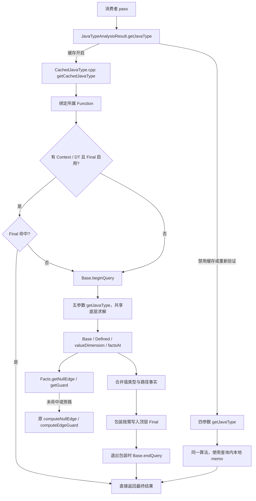
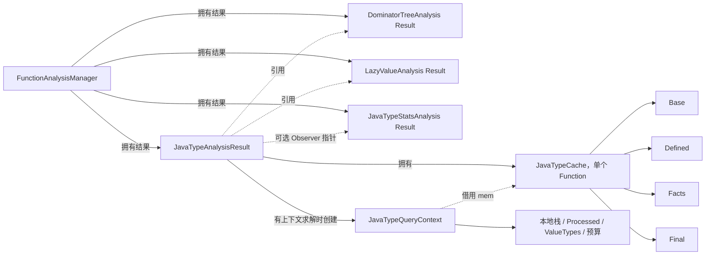

# 当前 JavaType 缓存架构

本文描述 `feat/javatype-final-cache` 的当前工作区：提交基点为
`68e75bd61`，其上正在完成类名、文件名和接口的去版本后缀调整。
原仓库对照基点为本地 `main` 的 `fa8d2209a`。以下统一使用当前名称；
历史实验数据仍对应各自记录的提交，不因命名调整而改变。相对于原仓库
的改动清单见 [架构改动说明](JavaTypeCacheArchitectureChanges.md)。

当前设计由一套共享求解器、一个缓存查询包装、四类函数级缓存，以及
AnalysisManager 生命周期和可选统计组成。缓存包装和策略保持独立；
原 `JavaType.cpp` 只加入共享存储、参数和必要计数的适配。

## 1. 运行路径与职责边界



四种查询入口的责任不同：

| 入口 | 用途 | 管理 Final / 绑定 / 查询统计边界 |
| --- | --- | --- |
| `JavaTypeAnalysisResult::getJavaType(V, Context)` | pass 常用入口，提供 DT/LVI、可选验证和观察事件 | 经缓存包装管理 |
| `getCachedJavaType(V, DT, Context, Oracle, Cache)` | 使用外部缓存的完整查询包装 | 是 |
| 五参数 `getJavaType(..., Cache)` | 原文件内共享求解器的外部 memo 入口 | 否 |
| 四参数 `getJavaType(...)` | 无跨查询 JavaType 缓存的求解 | 否，存储查询内创建 |

五参数入口供包装调用，直接使用时需要自行满足缓存所属 Function 等契约。
`sharpen` 也使用共享求解器和本地存储，但只求路径及指定边的约束。
当 `DT` 或 `Context` 为空时，查询只求基础类型，不创建 CFG 查询上下文，
也不查写 Final。

## 2. 文件组织

以下链接均指向当前源码，不依赖容易变化的行号。

| 文件 | 当前职责 |
| --- | --- |
| [JavaType.h](../../include/llvm/IR/Jeandle/JavaType.h) | 公共类型、类型运算、原四参数查询及五参数共享求解重载声明 |
| [JavaType.cpp](../../lib/IR/Jeandle/JavaType.cpp) | 唯一的 Base、definedness、条件追踪、值维度和 CFG 路径事实算法；新增共享求解适配单独分区 |
| [CachedJavaType.h](../../include/llvm/Analysis/Jeandle/CachedJavaType.h) / [.cpp](../../lib/Analysis/Jeandle/CachedJavaType.cpp) | 缓存查询包装：绑定、Base 查询生命周期、顶层 Final 查找与发布 |
| [JavaTypeCache.h](../../include/llvm/Analysis/Jeandle/JavaTypeCache.h) / [.cpp](../../lib/Analysis/Jeandle/JavaTypeCache.cpp) | 四类缓存、容器、命中计数、Facts 查表策略、显式失效和清空 |
| [JavaTypeAnalysis.h](../../include/llvm/Analysis/Jeandle/JavaTypeAnalysis.h) / [.cpp](../../lib/Analysis/Jeandle/JavaTypeAnalysis.cpp) | Function 分析所有权、FAM 依赖、查询路由、失效通知、LVI 清理和事件生成 |
| [JavaTypeAnalysisStats.h](../../include/llvm/Analysis/Jeandle/JavaTypeAnalysisStats.h) / [.cpp](../../lib/Analysis/Jeandle/JavaTypeAnalysisStats.cpp) | 观察事件累计、Function 统计、进程统计、打印与诊断开关 |
| [LVINullEdgeOracle.h](../../include/llvm/Analysis/Jeandle/LVINullEdgeOracle.h) / [.cpp](../../lib/Analysis/Jeandle/LVINullEdgeOracle.cpp) | 将 LVI 的结果适配成 null-edge oracle，不拥有 LVI |

原文件直接使用现有缓存类类型，当前 `LLVMCore` 的 JavaType 实现会包含
Analysis 目录的缓存头并引用其方法。依赖组织仍待整理；本文记录当前
实现，不将它描述为已经消除了 Core 与 Analysis 间的反向依赖。

## 3. 所有权与生命周期



四类缓存不跨 Function 共享，绑定后不能拿到另一个函数中使用。
键使用原始 IR 指针，没有自动跟踪任意操作数、metadata、RAUW 或删除的
通知机制。缓存也没有容量上限或按访问频次逐出；复用边界由语义失效决定。

AnalysisResult 拥有缓存，引用 FAM 的 DT/LVI。StatsAnalysis 的 Function
结果不因普通 IR 变化失效，因而能累计多个 JavaTypeAnalysisResult 生命周期
的查询数据，并为这些 Result 提供稳定的 observer。

## 4. 四类缓存

| 缓存 | Key → 值 | 复用范围 | 失效 |
| --- | --- | --- | --- |
| Base | `Value* → JavaType` | 与查询点无关的基础类型；可跨查询保留完成结果 | 删除受影响值；CFG 修改额外删除非叶子项 |
| Defined | `Value* → bool` | 已完成的 definedness 证明，包括“未证明” | 使用同一受影响列表；CFG 修改额外删除其非叶子项 |
| Facts.Guards | `(V, From, To) → JavaType` | 完整根 guard 调用从边条件提取的类型约束 | IR/oracle 通知时整体清空 |
| Facts.NullEdges | `(V, From, To) → bool` | 同一 oracle 有效期内“是否证明 V 在该边为 null” | IR/oracle 通知时整体清空 |
| Final | `(V, ContextBB) → JavaType` | 顶层查询的最终返回结果，Context 取所在块 | IR/oracle 通知时整体清空 |

`Defined == false` 表示没有证明输入排除 undef/poison，不表示必定为
undef/poison。`NullEdges == false` 同样是未证明为 null，不是证明非空。
Guards 的空结果和 Base 的 unknown 都可以是完整、可复用的保守答案。

Base 在 SCC 求解期间会暂存分量状态；只有整个查询结束后才能跨查询复用。
因此不允许在查询进行中修改 IR、失效缓存或并发操作同一缓存。

Final 只在包装的顶层入口读写，不代替递归 `factsAt`、PHI incoming 或
`valueDimension` 的计算。它只有普通结果表，没有依赖反向索引、null
问答记录或重验证。命中立即返回，不构造求解上下文，也不再次调用 oracle。

## 5. Facts 模式和 oracle 有效期

`JavaTypeFactsCache::getNullEdge`、`getGuard` 接收原计算的 `Compute`
回调；模式、查找、写入、统计均在缓存类中处理。原求解器只保留计算
helper，并在相应位置委托缓存类；回调只在本次调用期间使用，不被保存。

| 配置 | Guards | NullEdges | Final |
| --- | --- | --- | --- |
| 默认 `GuardOnly` | 根调用复用 | 每次调用 oracle/结构判断 | 不启用 |
| `StableOracleEpoch` | 根调用复用 | 允许复用 | `EnableFinal` 为 true 时启用 |

`getGuard` 还接收 `ConditionDepth`。只有深度为 0 的根调用读写表，嵌套
追踪旁路缓存，以保留原算法的递归深度限制。key 保留实际传入的 V，
不为增加命中率另行合并 identity/freeze 后可能具有不同 oracle 信息的值。

稳定模式由调用方承诺有效期内 oracle 结果可复用；Analysis 构造缓存时
使用此模式。单独维护或重置 oracle，即使 IR 没变，也必须通知。直接
使用聚合缓存时调用 `notifyOracleChanged()`，它清空 Facts/Final，保留
Base/Defined；Analysis 接口只提供更保守的 `clear()`，它还清理 LVI。

## 6. 查询内状态与原算法语义

共享求解器通过 `DefinedMemo` 选择自己的本地 bool 表或外部 Defined
缓存；`JavaTypeQueryContext` 同样选择本地或外部 Base。递归工作栈、
SCC 工作图、`Processed`、`ValueTypes`、PHI 环检测和求解预算仍查询内持有。

原 Base 使用 SCC 求解循环依赖；Defined 保守证明输入是否已定义。只有
证明输入已定义，才能把 freeze 当成 identity 并继承输入的 Java 类型。
路径事实继续按前驱边合并，使用原来的回边处理、null-edge 排除和截断规则。

不缓存依赖未完成递归栈的中间结果。Final 可缓存底层截断后返回的保守
顶层答案；预算不进入 key，提高预算不会自动细化既有 Final。需要重新
求解更精确结果时应清空。此处的求解预算与失效遍历上限是两件事。

## 7. 显式失效：修改 pass 提供 Changed

`Changed` 由修改 pass 主动提供，表示直接变动的 Value 根，不是 FAM
自动计算出的 IR diff。聚合缓存在修改前沿旧 `users()` 图展开 `Affected`；
若根是 BasicBlock，也将块内所有指令加入遍历。

普通修改默认按受影响 key 删除 Base/Defined。保留的 `Scan` 模式遍历整表
找出同样的 key，供性能对照；CFG 修改无论哪种模式都扫描并额外删除
非叶子项。“删除”指移除 memo 项，不是删除 IR 指令。

| CFG 变化后可保留的未受影响叶子 | 类型 |
| --- | --- |
| Base | Argument、Constant、Load；没有 identity 输入的 Call |
| Defined | Argument、Constant、Load、Call、Freeze、Alloca |

Facts/Final 不接收 `Affected`，收到语义修改通知后全清。遍历超过 4096 个
Value 或 16384 条 use 边、遇到不支持的根或跨函数对象时，四类缓存保守全清。
这些上限约束失效工作量，不是 DenseMap 容量限制。

```cpp
// RAUW/删除前保留完整旧 use 图，供 Base/Defined 传播影响。
JavaTypes.invalidate(*Old);
Old->replaceAllUsesWith(New);
Old->eraseFromParent();
```

操作数修改通知承载该操作数的指令；删除无 users 的缓存 key 也要通知。
删除块、插入/移动应覆盖相关块，结构修改设置 `CFGChanged=true`。
未知范围变化或 VM 类型信息变化走全清。普通 IR API 不自动调用上述通知。

## 8. AnalysisManager、DT 与 LVI

FAM 在 pass 边界调用 `invalidate(F, PA, Inv)`：未保留 JavaType 分析，
或 DT/LVI 分析失效时，丢弃整个 JavaTypeAnalysisResult。这是整体生命周期
判断，不计算 Changed，也不执行逐项失效。修改后在同一 pass 内继续查询，
不能依靠将来的 pass 边界失效补救。

`Result.invalidate(Changed)` 先维护 JavaType 缓存，再 `LVI.clear()`；
`Result.clear()` 清空四类缓存及 LVI，保留累计统计。调用方负责在下一次
查询前更新 DT。聚合缓存自身不拥有 DT/LVI，也不会代替调用方清理 LVI。
LVI 服务于多个消费者；null-edge 查询只使用其中一部分能力和结果。

LVI 的按需计算、缓存冷热与求解限制可能改变可证明信息。因此修改后
Facts/Final 随通知丢弃，不尝试仅凭 JavaType 的 SSA 依赖保留 oracle 结果。
调用方额外维护 LVI、IR 未变时，也要维护 JavaType 的 oracle 有效期。

## 9. 当前消费者

| 消费者 | 查询和修改方式 | 修改后的分析生命周期 |
| --- | --- | --- |
| [TypeCheckElimination](../../lib/Transforms/Jeandle/TypeCheckElimination.cpp) | 先收集折叠决定，批量通知旧检查，再替换 | 维护后 preserve JavaType、DT、LVI |
| [CHADevirtualization](../../lib/Transforms/Jeandle/CHADevirtualization.cpp) | 调用改写、assume 和 CFG 处理间可能继续查询，通知相应根，刷新 DT/LVI | 维护后 preserve JavaType、DT、LVI |
| [ConstantFieldFolding](../../lib/Transforms/Jeandle/ConstantFieldFolding.cpp) | 多轮查询与折叠交替，替换/删除前通知，包括死 GEP | 修改后只 preserve CFG 类分析，FAM 丢弃 JavaType |
| [RecoverTypeInfo](../../lib/Transforms/Jeandle/RecoverTypeInfo.cpp) | 所有类型查询先于 metadata 写入阶段 | 修改后不 preserve JavaType，FAM 在边界丢弃 |
| [CopySpecialization](../../lib/Transforms/Jeandle/CopySpecialization.cpp) | arraycopy 源/目标、instance-clone 源共三处类型查询，先收集全部 CopyFacts，再改写 | 有修改时返回 none，由 FAM 丢弃 JavaType、DT、LVI；改写阶段不再查询，无需逐项通知 |

五个消费者共九个源码查询点使用同一个 Function 分析入口；这些是静态
调用位置数量，不是运行时查询次数。是否跨 pass 保留取决于
实际 `PreservedAnalyses`。没有查询的 pass 也可能令已有分析失效。

## 10. 统计与验证

统计默认关闭。启用 `-jeandle-java-type-stats` 后，流水线是：

```text
各缓存累计 Counters
  → AnalysisResult 在查询前后取差分，生成 Query/Invalidation Event
  → 可选 JavaTypeQueryObserver
  → JavaTypeStatsAnalysis 的 Function 累计值 + 进程级 Statistic
  → Function printer / Module summary / -stats 输出
```

无 observer 时不构造计数快照、不生成事件、不读计时时钟；缓存的
`record*` 调用及其开关检查仍在，不能宣称完全没有统计调用开销。
`clear()` 不重置累计计数，`resetStats()` 才重置缓存本身的计数。
CopySpecialization 通过同一分析入口生成事件，clone 和 arraycopy 查询
自动加入现有统计，无需修改事件 schema 或另加专用计数。Function 统计
独立于查询缓存生命周期；分析被 FAM 丢弃后仍可打印累计命中数。条目
数量是最近一次事件记录的快照，不保证等于分析丢弃后的实际存活缓存数。
`PreservedAnalyses::none()` 引起的 FAM 边界丢弃不会生成显式失效事件，
因此 `invalidation requests: 0` 不代表缓存被保留；应使用 cache-boundary
的 `existing_analysis=0` 或 `FAM.getCachedResult` 判断分析是否仍存在。

跨查询/本查询 Base 命中细分需要显式 `setDetailedStatsEnabled(true)`，
并且统计已启用，才在查询开始建立旧 key 快照；Analysis 默认不开此详细项。
普通 hit 次数包含同一次求解内的重复访问，不应直接当成跨查询收益。
Current/Peak 是最近事件报告的缓存大小及峰值，不是打印时读取缓存的实时
结果；进程级汇总可能包含此前处理的 Function 或 Module。
Facts helper 次数、LVI 内部 solve 次数和总耗时也不能互相替代。

`-jeandle-disable-java-type-cache` 使用四参数路径；
`-jeandle-verify-java-type-cache` 用该路径重算并比较完整 JavaType。
它与缓存路径使用同一求解器、同一个 DT/LVI，不是独立算法或全新 LVI
实例，因此主要检查复用和失效一致性；独立构建 DT/AC/LVI 的测试另作补充。

## 11. 当前验证与待评估项

最近一次命名清理后的代码验证已完成 `JavaTypeQueryTests`、`IRTests`、
`opt`、`llvm-as` 构建；查询与 Analysis 测试 76/76（缓存 40 项、查询及
Analysis 36 项）、原 Base 测试 69/69 通过，Jeandle lit 783 通过、
25 unsupported、0 失败。这些为新增 CopySpecialization 接入前的记录；
新增消费者的回归结果见下一节。这些是 LLVM IR 与单元测试回归；例如
`x07-production-pipeline` 显式禁用了 PEA，不代表完整 JVM 编译流水线
的端到端验证。

本轮尚未重跑 perf，不能据此声称轻量 Final 或共享求解器已带来时间收益。
仍需在同样输入、求解器、统计开关和 LVI 条件下比较总耗时、首次写入、
Final 命中、修改失效与重算成本。历史性能原始数据继续按原提交解释。

## 12. CopySpecialization 接入验证范围

新增 [cache-reuse.ll](../../test/Jeandle/copy-specialization/cache-reuse.ll)
在同一块连续分析两个 clone 站点，分别覆盖未知源类型与已知但拒绝字段
标量化的源类型。两个站点先查询、后扩展到 bulk helper，期望每个函数
两次查询、一次 Final 命中；改写后 cache-boundary 检查旧分析已被丢弃。
测试还比较禁用缓存和严格验证模式的完整输出 IR，验证统计和结果一致性。
这些属于真实 pass 的机制回归，尚不能解释为 clone/arraycopy 性能收益。
本轮验证（2026-11-03）：`JavaTypeQueryTests` 构建通过，79/79 通过，
其中缓存测试 40 项、查询与 Analysis 测试 39 项；CopySpecialization
定向 lit 11/11 通过，包括新增复用测试与三个已有 fixture 的输出对照。
`integer-width.ll` 还检查 arraycopy 的源/目标两次查询均进入统计，
payload array-clone 分支没有类型查询。完整 Jeandle lit 共 809 项，
784 通过、25 unsupported、0 失败。底层求解、缓存类和统计 schema
未因本次接入改动，新增三处调用复用现有统计流程；未重跑 perf。
