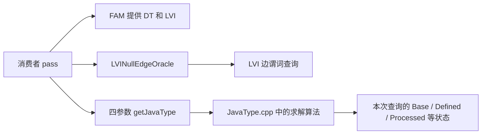

# JavaType 缓存：相对原架构的变动清单

本文回答“缓存开发对原架构改了什么”。当前结构及运行流程另见
[JavaTypeCacheArchitecture.md](JavaTypeCacheArchitecture.md)。

比较基线是本地 `main` 的 `fa8d2209a`，目标是
`feat/javatype-final-cache` 的当前工作区：已提交至 `68e75bd61`，并包含
尚未提交的命名清理。本文同时检查工作区新增文件；仅执行
`git diff main` 会漏掉尚未跟踪的重命名目标。

这里区分两种变化：一是相对 main 的最终净变化，二是分支开发过程中
曾经存在、现在已经删除的实验结构。原算法已有的能力不记为本次新增。

## 1. 原来的调用与所有权

原来的消费者通常自行从 FunctionAnalysisManager 获取 DT、LVI，
构造 `LVINullEdgeOracle`，再直接调用四参数 `jeandle::getJavaType`。

main 已有 Base 的迭代 SCC 求解、definedness 证明、freeze 检查、
identity 匹配、条件追踪和 CFG 路径事实计算。RecoverTypeInfo 中的
每-load 查询 memo、入边 sharpening memo 也已存在。

原来没有统一持有四类跨查询缓存的 JavaTypeAnalysis。查询结束后，
JavaType 内部的局部状态结束生命周期；消费者自己的局部 memo 另行管理。

## 2. 最终净变化概览

| 位置 | 原来 | 当前变化 |
| --- | --- | --- |
| JavaType 查询算法 | 只使用查询内存储 | 算法保持一份，通过必要接口选择本地或外部 memo |
| 缓存所有权 | 没有统一的四类缓存所有者 | 新增 Function 级 JavaTypeCache 聚合及四个缓存类 |
| 查询包装 | pass 直接调用原查询接口 | 新增独立 getCachedJavaType，管理 Final 和查询生命周期 |
| AnalysisManager | DT/LVI 由消费者分别获取 | 新增 JavaTypeAnalysis，持有缓存并引用 DT/LVI |
| 修改维护 | 无统一 JavaType 缓存通知 | 新增显式修改通知、选择性失效及框架失效入口 |
| LVI oracle | 定义在 Transforms 工具中 | 迁移为 Analysis 下的独立头文件和实现 |
| 五个消费者 | 直接调用原 getJavaType | 统一调用 JavaTypeAnalysisResult::getJavaType |
| 统计和诊断 | 无当前这套缓存观测机制 | 新增缓存计数、事件、函数累计、进程汇总及诊断 pass |
| 构建和注册 | 没有缓存分析及查询测试目标 | 注册分析、诊断 pass，增加缓存源文件及测试目标 |
| 验证和实验材料 | 没有本分支的缓存实验材料 | 新增单测、真实 pass 回归、perf 脚本及历史结果 |

## 3. 原 JavaType 文件中的逐项改动

对应文件：[JavaType.h](../../include/llvm/IR/Jeandle/JavaType.h)、
[JavaType.cpp](../../lib/IR/Jeandle/JavaType.cpp)。

### 3.1 保留四参数入口，新增共享求解接口

原四参数 `getJavaType(V, DT, Context, IsNullEdge)` 保留，继续使用局部
memo。新增五参数重载，额外接受 `JavaTypeCache &`，让独立缓存包装
复用原求解器的 Base、Defined、Facts 计算。

五参数重载不负责 Final，不绑定 Function，也不调用 Base 的
`beginQuery/endQuery`。这些职责在独立的 `CachedJavaType.cpp` 中。
`JavaType.h` 相应增加缓存类的前置声明和重载声明。

### 3.2 DefinedMemo 从 map 别名变为存储选择器

原来是 `DenseMap<Value *, bool>` 的私有别名。现在是私有结构：

- `Local`：普通查询使用的本地 bool 表。
- `Shared`：可选的 `JavaTypeDefinedCache *`。
- `storage()`：选择本地表或外部表。

这样 freeze 与条件匹配辅助函数继续接受同一种 DefinedMemo，不需要
把外部缓存参数逐层加到所有辅助函数上。`isProvenDefined` 的工作图和
证明/传播算法保持原样，只增加存储选择和统计。

### 3.3 Base 求解只增加外部统计接入

原私有 `getBaseJavaType` 已经有可选的 `BaseMemo *` 和 `DefinedMemo *`
参数。当前保留这两个入口，额外增加可选的 `JavaTypeBaseCache *`，用于
记录入口命中、节点、输入边、循环和精化等统计。

没有新增另一套 SCC 算法，也没有改变 unknown、freeze 或循环传播规则。
Base 完成结果的存储可以来自外部；正在求解的工作图仍属于本次调用。

### 3.4 JavaTypeQueryContext 选择本地或共享存储

新增可选的 `JavaTypeCache *Cache`；原 `BaseTypes` 本地 map 调整为
`LocalBaseTypes` 加实际使用的 `BaseTypes` 引用。DefinedValues 使用上述
本地/共享选择器。

`Processed`、`ValueTypes`、PHI/值递归状态、循环计数、FactsBudget、
PhiBudget、ConditionDepth 继续按查询创建，没有变成跨查询缓存。

### 3.5 两个边辅助函数拆出计算与适配

| 原函数 | 当前原计算 | 新增适配 |
| --- | --- | --- |
| isNullEdge | computeNullEdge，函数体保持一致 | 无缓存直接计算；有缓存委托 Facts.getNullEdge |
| edgeGuard | computeEdgeGuard，函数体保持一致 | 无缓存直接计算；有缓存委托 Facts.getGuard |

原调用位置仍使用 `isNullEdge/edgeGuard`。新增适配定义集中放在文件末尾
“Shared solver interfaces” 区块，因此前面增加了两个前置声明。
声明和定义不是两套实现。

新增适配向 Facts 传入一个同步执行原计算的 Compute 回调；模式检查、
查找、写入、条件深度旁路和缓存统计仍由独立缓存文件完成。

### 3.6 当前的依赖方向也发生了变化

`JavaType.cpp` 当前包含 Analysis 下的 `JavaTypeCache.h`，并直接使用
缓存类及其统计方法。源文件仍由 LLVMCore 构建，缓存类实现由 LLVMAnalysis
构建。这是当前实际状态；按本轮约定先保留直接接入方式，库的依赖组织
尚未进一步整理。没有引入另一套缓存视图或查询框架。

## 4. 独立缓存文件新增了什么

新增 [JavaTypeCache.h](../../include/llvm/Analysis/Jeandle/JavaTypeCache.h)
及 [JavaTypeCache.cpp](../../lib/Analysis/Jeandle/JavaTypeCache.cpp)：

| 类 | 新增的复用范围 | 当前失效方式 |
| --- | --- | --- |
| JavaTypeBaseCache | Value 到完成基础类型结果 | 删除受影响 keys；CFG 修改额外删除非叶子项 |
| JavaTypeDefinedCache | Value 到完成 definedness 结果 | 同一 affected 闭包；叶子标准按 Defined 算法定义 |
| JavaTypeFactsCache | 两张边缓存：guard 类型约束、null 判断 | IR 通知或 oracle 维护时全清 |
| JavaTypeFinalCache | Value 与 ContextBB 到顶层完整结果 | IR 通知或 oracle 维护时全清 |
| JavaTypeCache | 单函数聚合所有权、统一通知和开关 | 收集影响范围，分派给四个子缓存，必要时全清 |

Defined 的 false 表示“未证明 defined”，不表示“一定是 poison”。
默认 GuardOnly 只缓存根 guard；StableOracleEpoch 才允许 null 判断和
Final 复用，调用方需遵守 oracle 维护通知契约。

新增 [CachedJavaType.h](../../include/llvm/Analysis/Jeandle/CachedJavaType.h)
及 [CachedJavaType.cpp](../../lib/Analysis/Jeandle/CachedJavaType.cpp)：
它们提供缓存查询入口，负责绑定 Function、Final 命中/发布，以及 Base
查询起止统计；未命中时调用五参数共享求解接口。

Final 的当前条目只有 JavaType，不保存依赖集合、反向索引或 null 判断
观察，不重验证，也没有缓存容量预算。底层求解预算继续属于原算法。

## 5. AnalysisManager 与修改维护

新增 [JavaTypeAnalysis.h](../../include/llvm/Analysis/Jeandle/JavaTypeAnalysis.h)
及 [JavaTypeAnalysis.cpp](../../lib/Analysis/Jeandle/JavaTypeAnalysis.cpp)。

- JavaTypeAnalysisResult 拥有单个 Function 的 JavaTypeCache。
- DT、LVI 由 FAM 持有，Result 只借用引用，不建立另一份 DT/LVI。
- 查询默认走缓存包装；关闭缓存开关使其调用四参数原入口。
- 显式 `invalidate(Changed, CFGChanged)` 用于同一 pass 内的修改维护。
- FAM 的 `invalidate(F, PA, Inv)` 用于 pass 边界判断整个 Result 是否丢弃。

显式通知在旧 use 图仍存在时，从 pass 给出的 Changed 沿 users 收集
Affected。基本块通知还展开块内指令。Base、Defined 用它选择性删除；
Facts、Final 全清。遇到非局部/跨函数对象或超过 4096 个值、16384 条
use 边，回退到四类全清。这里的限制是失效遍历保护，不是容量限制。

Analysis 的显式通知还清空 LVI；下一次查询前由修改 pass 维护 DT。
`clear()` 清四类缓存和 LVI。普通 LLVM IR 修改 API 不会自动生成 Changed，
也没有为所有 key 安装自动监听的 ValueHandle。

框架在 pass 边界依据 PreservedAnalyses 处理整个 Result。JavaType、DT、
LVI 没有按契约保留时，本分析失效。不能把框架边界失效当作同一 pass 内
继续使用旧结果的补救。

## 6. LVINullEdgeOracle 是迁移，不是新增分析

main 中该结构声明在 JeandleTransformUtils.h，实现也在对应 cpp。
现在迁到独立的 [LVINullEdgeOracle.h](../../include/llvm/Analysis/Jeandle/LVINullEdgeOracle.h)
和 [LVINullEdgeOracle.cpp](../../lib/Analysis/Jeandle/LVINullEdgeOracle.cpp)。

它仍在 llvm 命名空间，只保存 LazyValueInfo 引用；调用运算符新增
LLVM_ABI 导出标记，注释明确修改后的维护契约。当前调用运算符函数体
与 main 中被迁出的实现逐字一致。因此 freeze 检查、直接分支快速判断
和 LVI 回退均不是本次迁移新创造的算法。

原 Transforms 文件删除声明和实现，相关用户改为包含新头文件。
CopySpecialization 原先也包含迁移后的 oracle 头，后续接入统一分析时，
直接 DT/LVI/oracle 依赖改为获取 JavaTypeAnalysisResult；类型查询统一
走该分析，oracle 由分析入口提供。

## 7. 五个消费者、九个查询点的接入改动

| Pass | 查询变化 | 修改维护及返回时的处理 |
| --- | --- | --- |
| TypeCheckElimination | 1 处改为 JavaTypes.getJavaType | 将 Fold.Check 批量组成 Changed，在应用折叠前通知；维护后保留 JavaType、DT、LVI |
| CHADevirtualization | 2 处改为 JavaTypes.getJavaType | 辅助函数传入分析；覆盖 assume、参数、替换/删除和 CFG 通知；修改后 flush DT、清 LVI，再继续查询并保留分析 |
| ConstantFieldFolding | 2 处改为 JavaTypes.getJavaType | helper 接受分析；替换/删除前通知，连 use-empty 的 load/GEP 也覆盖；有修改时只保留 CFG，JavaType 在边界丢弃 |
| RecoverTypeInfo | 1 处改为 JavaTypes.getJavaType | 查询在最终 metadata 写入前完成；有修改时只保留 CFG，JavaType 在边界丢弃 |
| CopySpecialization | 3 处改为 JavaTypes.getJavaType | arraycopy 源/目标及 instance-clone 源查询先生成全部 CopyFacts；再改写；有修改返回 none，FAM 丢弃 JavaType/DT/LVI |

CHA 还增加 IRChanged，确保失败的 MethodHandle 优化尝试若实际插入、删除
或修改了 IR，也会触发外层维护。它原来已有的 rebuilt-site 延迟处理循环
不是本次新增。TCE 原来已有先决定再统一折叠的策略，本次只补批量通知。

CopySpecialization 保留原先“先分析所有站点，再执行改写”的顺序；新增的
只是 JavaType 查询来源和统一统计接入。第一次改写后没有类型查询，
因此不需要逐项 invalidate。拒绝字段标量化的 clone 仍可能扩展成 bulk
helper，不能把“拒绝标量化”当成“pass 没有修改”。

RecoverTypeInfo 原有的 CtxCache、EdgeSharpenCache 继续存在；其直接
sharpen 调用是入边语义，不能等同于整值查询绕过缓存。

## 8. 统计、诊断与实验开关

新增 [JavaTypeAnalysisStats.h](../../include/llvm/Analysis/Jeandle/JavaTypeAnalysisStats.h)
及 [JavaTypeAnalysisStats.cpp](../../lib/Analysis/Jeandle/JavaTypeAnalysisStats.cpp)。

当前实际链路是：缓存自身累计计数 → Analysis 查询前后快照做差 →
Query/Invalidation Event → Observer → Function 累计统计和进程级 Total。
JavaTypeStatsAnalysis 的结果不因 IR 修改失效，以跨缓存 Result 生命周期
保留观测数据。Current/Peak 来自事件报告的大小，不是打印时直接遍历缓存。

| 开关/入口 | 当前功能 |
| --- | --- |
| -jeandle-disable-java-type-cache | 走原四参数接口，对照无跨查询缓存的求解 |
| -jeandle-verify-java-type-cache | 用原入口复算并比较完整 JavaType |
| -jeandle-java-type-stats | 启用 observer、计数、计时及汇总 |
| -jeandle-java-type-query-trace | 在启用统计后输出逐查询诊断 |
| -jeandle-java-type-force-full-invalidation | 通知时强制全清，用于对照实验 |
| -jeandle-java-type-force-base-scan-invalidation | Base/Defined 改走全表扫描删除路径 |
| print<java-type-analysis> | 输出函数统计 |
| print<java-type-analysis-summary> | 输出当前进程累计统计 |
| jeandle-java-type-cache-boundary | 实验用缓存边界，只清已有分析结果 |

CopySpecialization 查询直接进入这条既有链路，Function 与进程汇总自动
包含 clone 和 arraycopy 的工作量，不新增统计字段。分析被丢弃后累计值
继续存在；条目数量字段是最近事件快照，不是已销毁缓存的实时大小。
FAM 在 pass 边界丢弃分析不会发送显式失效事件；所以没有 invalidation
请求不能证明缓存仍被保留，需另查 FAM 或 cache-boundary 的存活状态。

关闭统计后，不创建 observer，也不复制查询前后快照或读计时时钟；部分
record 方法调用与 begin/end 管理仍存在。详细的 PriorKeys 快照仅在显式
开启详细统计时执行。统计简化只是待讨论方案，目前没有实施。

## 9. 构建、注册、测试和 perf 工具

| 文件/位置 | 相对 main 的变化 |
| --- | --- |
| lib/Analysis/CMakeLists.txt | 加入 CachedJavaType、JavaTypeCache、Analysis、Stats、Oracle 五个实现 |
| lib/Passes/PassBuilder.cpp | 包含两种分析相关头文件 |
| lib/Passes/PassRegistry.def | 注册 JavaType/Stats 两种函数分析、函数 printer、模块 summary、实验边界 pass |
| unittests/IR/CMakeLists.txt | 增加 JavaTypeQueryTests，包含两个查询测试文件并链接 LLVMJeandleTransforms |
| unittests/IR/JavaTypeTest.cpp | 为已有 TCE 测试引入并注册 JavaTypeAnalysis；原测试 IR、断言未变 |
| test/Jeandle 下新增 fixtures | 覆盖失效、五个真实消费者、跨 pass 复用和分析边界 |
| utils/jeandle 下三个 Python 工具 | invalidation/design 对照、计时、perf 采样及源码身份记录 |

新增 CopySpecialization 接入前的代码验证记录是缓存/Analysis 测试
76/76、原算法测试 69/69；
完整 Jeandle lit 为 783 通过、25 unsupported、0 失败。
单测使用合成 VM callbacks，部分使用真实 DT/LVI；lit 跑真实优化 pass
并回放 VM callbacks。它们不是 JVM 端到端验证，x07 用例还显式关闭 PEA。

当前冷查询与缓存查询共享同一求解器。普通验证开关使用同一 DT/LVI，
只隔离 JavaType 的跨查询 memo；部分专项测试才另建 DT/AC/LVI。
这些对照不能替代独立算法证明，原算法固定预期测试仍需保留。

历史 Results.json/Samples.csv 未改写，不能当作当前最终实现的性能结果。
最终共享求解器和轻量 Final 尚未重新跑 perf。

### CopySpecialization 本轮验证（2026-11-03）

查询测试目标构建通过，79/79 通过（缓存测试 40 项、查询与 Analysis
39 项）；CopySpecialization 定向 lit 11/11 通过；完整 Jeandle lit 共
809 项，784 通过、25 unsupported、0 失败。

新增复用测试检查两个 clone 站点同块查询的 Final 命中、FAM 边界丢弃，
以及缓存/禁用缓存/严格验证模式的完整输出一致性；三个已有 fixture
补充实际 clone 与 arraycopy 改写的缓存/禁用缓存输出对照。整数宽度
fixture 还直接检查 arraycopy 源/目标查询计数与 payload array-clone
不查询 JavaType 的分支。

本轮底层求解、缓存类与统计 schema 未改，新增消费者的三处调用自动
加入既有统计。没有运行新的计时或 perf，历史性能数据没有重写。

## 10. 分支历史中已撤掉的实验结构

这些属于开发历史变化，并非“从 main 删除了原有功能”：

- e9d7bdb82：Final 从依赖集合、反向索引和 null 问答重验证，简化为
  普通结果表与通知时全清；相应旁路、验证统计移除。
- 6c1d6b871：删除旧查询副本及专属测试、原生 benchmark、reuse replay；
  有用的测试迁到当前接口，历史性能数据保留。
- 68e75bd61：取消缓存文件中整份算法复制，接回原求解器；缓存入口与
  缓存策略仍保留独立文件，底层只增加必要适配接口。
- 当前命名清理：去掉类、接口、测试、文档和文件名的版本后缀。当前
  CachedJavaType.h/.cpp 虽与旧文件同名，内容属于当前共享求解器架构。

## 11. 待讨论事项与附带差异

尚未完成的设计事项包括统计瘦身、Core 与 Analysis 缓存类型的依赖组织，
以及最终版本的性能复测。它们没有在本文中写成已经实现的改进。

本地 main 本身的 PEA 更新不属于缓存架构改动。相对 main 还存在两处
不承载架构功能的遗留差异：benchmarks/CMakeLists.txt 删除了一个空行，
SCC-getBaseType.md 是空的历史文档。本文记录它们，但没有顺手修改或删除。

## 附录：相对 main 的文件清单

下面按实际文件状态列出累计变动，包含尚未跟踪的当前命名目标。A 表示
main 中没有而工作区存在，M 表示内容不同；不把 Git 历史中的旧名字当作
当前仍存在的实现。

| 状态 | 文件 |
| --- | --- |
| M | [llvm/benchmarks/CMakeLists.txt](../../benchmarks/CMakeLists.txt) |
| A | [llvm/docs/JeandleJavaTypeInvalidation.md](../JeandleJavaTypeInvalidation.md) |
| A | [llvm/docs/JeandleJavaTypeInvalidation/CachedJavaTypeDataStructures.csv](CachedJavaTypeDataStructures.csv) |
| A | [llvm/docs/JeandleJavaTypeInvalidation/CachedJavaTypeStudy.md](CachedJavaTypeStudy.md) |
| A | [llvm/docs/JeandleJavaTypeInvalidation/FactsEdgeCache.md](FactsEdgeCache.md) |
| A | [llvm/docs/JeandleJavaTypeInvalidation/JavaTypeCacheArchitecture.md](JavaTypeCacheArchitecture.md) |
| A | [llvm/docs/JeandleJavaTypeInvalidation/JavaTypeCacheArchitectureChanges.md](JavaTypeCacheArchitectureChanges.md) |
| A | [llvm/docs/JeandleJavaTypeInvalidation/JavaTypeCacheDesign.md](JavaTypeCacheDesign.md) |
| A | [llvm/docs/JeandleJavaTypeInvalidation/JavaTypeDataStructures.csv](JavaTypeDataStructures.csv) |
| A | [llvm/docs/JeandleJavaTypeInvalidation/JavaTypeInterfaces.csv](JavaTypeInterfaces.csv) |
| A | [llvm/docs/JeandleJavaTypeInvalidation/Results.json](Results.json) |
| A | [llvm/docs/JeandleJavaTypeInvalidation/SCC-getBaseType.md](SCC-getBaseType.md) |
| A | [llvm/docs/JeandleJavaTypeInvalidation/Samples.csv](Samples.csv) |
| A | [llvm/include/llvm/Analysis/Jeandle/CachedJavaType.h](../../include/llvm/Analysis/Jeandle/CachedJavaType.h) |
| A | [llvm/include/llvm/Analysis/Jeandle/JavaTypeAnalysis.h](../../include/llvm/Analysis/Jeandle/JavaTypeAnalysis.h) |
| A | [llvm/include/llvm/Analysis/Jeandle/JavaTypeAnalysisStats.h](../../include/llvm/Analysis/Jeandle/JavaTypeAnalysisStats.h) |
| A | [llvm/include/llvm/Analysis/Jeandle/JavaTypeCache.h](../../include/llvm/Analysis/Jeandle/JavaTypeCache.h) |
| A | [llvm/include/llvm/Analysis/Jeandle/LVINullEdgeOracle.h](../../include/llvm/Analysis/Jeandle/LVINullEdgeOracle.h) |
| M | [llvm/include/llvm/IR/Jeandle/JavaType.h](../../include/llvm/IR/Jeandle/JavaType.h) |
| M | [llvm/include/llvm/Transforms/Jeandle/JeandleTransformUtils.h](../../include/llvm/Transforms/Jeandle/JeandleTransformUtils.h) |
| M | [llvm/lib/Analysis/CMakeLists.txt](../../lib/Analysis/CMakeLists.txt) |
| A | [llvm/lib/Analysis/Jeandle/CachedJavaType.cpp](../../lib/Analysis/Jeandle/CachedJavaType.cpp) |
| A | [llvm/lib/Analysis/Jeandle/JavaTypeAnalysis.cpp](../../lib/Analysis/Jeandle/JavaTypeAnalysis.cpp) |
| A | [llvm/lib/Analysis/Jeandle/JavaTypeAnalysisStats.cpp](../../lib/Analysis/Jeandle/JavaTypeAnalysisStats.cpp) |
| A | [llvm/lib/Analysis/Jeandle/JavaTypeCache.cpp](../../lib/Analysis/Jeandle/JavaTypeCache.cpp) |
| A | [llvm/lib/Analysis/Jeandle/LVINullEdgeOracle.cpp](../../lib/Analysis/Jeandle/LVINullEdgeOracle.cpp) |
| M | [llvm/lib/IR/Jeandle/JavaType.cpp](../../lib/IR/Jeandle/JavaType.cpp) |
| M | [llvm/lib/Passes/PassBuilder.cpp](../../lib/Passes/PassBuilder.cpp) |
| M | [llvm/lib/Passes/PassRegistry.def](../../lib/Passes/PassRegistry.def) |
| M | [llvm/lib/Transforms/Jeandle/CHADevirtualization.cpp](../../lib/Transforms/Jeandle/CHADevirtualization.cpp) |
| M | [llvm/lib/Transforms/Jeandle/ConstantFieldFolding.cpp](../../lib/Transforms/Jeandle/ConstantFieldFolding.cpp) |
| M | [llvm/lib/Transforms/Jeandle/CopySpecialization.cpp](../../lib/Transforms/Jeandle/CopySpecialization.cpp) |
| M | [llvm/lib/Transforms/Jeandle/JeandleTransformUtils.cpp](../../lib/Transforms/Jeandle/JeandleTransformUtils.cpp) |
| M | [llvm/lib/Transforms/Jeandle/RecoverTypeInfo.cpp](../../lib/Transforms/Jeandle/RecoverTypeInfo.cpp) |
| M | [llvm/lib/Transforms/Jeandle/TypeCheckElimination.cpp](../../lib/Transforms/Jeandle/TypeCheckElimination.cpp) |
| A | [llvm/test/Jeandle/constant-field-folding/Inputs/cache-reuse.cblog](../../test/Jeandle/constant-field-folding/Inputs/cache-reuse.cblog) |
| A | [llvm/test/Jeandle/constant-field-folding/cache-reuse.ll](../../test/Jeandle/constant-field-folding/cache-reuse.ll) |
| A | [llvm/test/Jeandle/copy-specialization/Inputs/cache-reuse.cblog](../../test/Jeandle/copy-specialization/Inputs/cache-reuse.cblog) |
| A | [llvm/test/Jeandle/copy-specialization/cache-reuse.ll](../../test/Jeandle/copy-specialization/cache-reuse.ll) |
| M | [llvm/test/Jeandle/copy-specialization/clone-instance.ll](../../test/Jeandle/copy-specialization/clone-instance.ll) |
| M | [llvm/test/Jeandle/copy-specialization/integer-width.ll](../../test/Jeandle/copy-specialization/integer-width.ll) |
| M | [llvm/test/Jeandle/copy-specialization/reference-array-scalarize.ll](../../test/Jeandle/copy-specialization/reference-array-scalarize.ll) |
| A | [llvm/test/Jeandle/java-type-analysis/Inputs/selective-invalidation.cblog](../../test/Jeandle/java-type-analysis/Inputs/selective-invalidation.cblog) |
| A | [llvm/test/Jeandle/java-type-analysis/selective-invalidation.ll](../../test/Jeandle/java-type-analysis/selective-invalidation.ll) |
| A | [llvm/test/Jeandle/java-type-cache-reuse/Inputs/cff-modify-tce.cblog](../../test/Jeandle/java-type-cache-reuse/Inputs/cff-modify-tce.cblog) |
| A | [llvm/test/Jeandle/java-type-cache-reuse/Inputs/cff-nonexact.cblog](../../test/Jeandle/java-type-cache-reuse/Inputs/cff-nonexact.cblog) |
| A | [llvm/test/Jeandle/java-type-cache-reuse/Inputs/cha-reuse.cblog](../../test/Jeandle/java-type-cache-reuse/Inputs/cha-reuse.cblog) |
| A | [llvm/test/Jeandle/java-type-cache-reuse/Inputs/pipeline-tce-cff.cblog](../../test/Jeandle/java-type-cache-reuse/Inputs/pipeline-tce-cff.cblog) |
| A | [llvm/test/Jeandle/java-type-cache-reuse/Inputs/recover-cha.cblog](../../test/Jeandle/java-type-cache-reuse/Inputs/recover-cha.cblog) |
| A | [llvm/test/Jeandle/java-type-cache-reuse/Inputs/recover.cblog](../../test/Jeandle/java-type-cache-reuse/Inputs/recover.cblog) |
| A | [llvm/test/Jeandle/java-type-cache-reuse/Inputs/tce-recover.cblog](../../test/Jeandle/java-type-cache-reuse/Inputs/tce-recover.cblog) |
| A | [llvm/test/Jeandle/java-type-cache-reuse/Inputs/tce.cblog](../../test/Jeandle/java-type-cache-reuse/Inputs/tce.cblog) |
| A | [llvm/test/Jeandle/java-type-cache-reuse/cff-modify-tce.ll](../../test/Jeandle/java-type-cache-reuse/cff-modify-tce.ll) |
| A | [llvm/test/Jeandle/java-type-cache-reuse/cff-nonexact.ll](../../test/Jeandle/java-type-cache-reuse/cff-nonexact.ll) |
| A | [llvm/test/Jeandle/java-type-cache-reuse/cha-deep.ll](../../test/Jeandle/java-type-cache-reuse/cha-deep.ll) |
| A | [llvm/test/Jeandle/java-type-cache-reuse/cha-shallow.ll](../../test/Jeandle/java-type-cache-reuse/cha-shallow.ll) |
| A | [llvm/test/Jeandle/java-type-cache-reuse/recover-cha-boundary.ll](../../test/Jeandle/java-type-cache-reuse/recover-cha-boundary.ll) |
| A | [llvm/test/Jeandle/java-type-cache-reuse/recover-shallow.ll](../../test/Jeandle/java-type-cache-reuse/recover-shallow.ll) |
| A | [llvm/test/Jeandle/java-type-cache-reuse/tce-cff-cross-pass.ll](../../test/Jeandle/java-type-cache-reuse/tce-cff-cross-pass.ll) |
| A | [llvm/test/Jeandle/java-type-cache-reuse/tce-deep.ll](../../test/Jeandle/java-type-cache-reuse/tce-deep.ll) |
| A | [llvm/test/Jeandle/java-type-cache-reuse/tce-fold-recover.ll](../../test/Jeandle/java-type-cache-reuse/tce-fold-recover.ll) |
| A | [llvm/test/Jeandle/java-type-cache-reuse/tce-recover-cross-pass.ll](../../test/Jeandle/java-type-cache-reuse/tce-recover-cross-pass.ll) |
| A | [llvm/test/Jeandle/java-type-cache-reuse/tce-same-block.ll](../../test/Jeandle/java-type-cache-reuse/tce-same-block.ll) |
| A | [llvm/test/Jeandle/java-type-cache-reuse/tce-shallow.ll](../../test/Jeandle/java-type-cache-reuse/tce-shallow.ll) |
| A | [llvm/test/Jeandle/java-type-cache-reuse/tce-zero-overlap.ll](../../test/Jeandle/java-type-cache-reuse/tce-zero-overlap.ll) |
| A | [llvm/test/Jeandle/java-type-cache-reuse/x07-production-pipeline.ll](../../test/Jeandle/java-type-cache-reuse/x07-production-pipeline.ll) |
| A | [llvm/test/Jeandle/java-type-metadata-recovery/Inputs/recover-shared-base-cache.cblog](../../test/Jeandle/java-type-metadata-recovery/Inputs/recover-shared-base-cache.cblog) |
| A | [llvm/test/Jeandle/java-type-metadata-recovery/recover-shared-base-cache.ll](../../test/Jeandle/java-type-metadata-recovery/recover-shared-base-cache.ll) |
| M | [llvm/unittests/IR/CMakeLists.txt](../../unittests/IR/CMakeLists.txt) |
| A | [llvm/unittests/IR/CachedJavaTypeTest.cpp](../../unittests/IR/CachedJavaTypeTest.cpp) |
| A | [llvm/unittests/IR/JavaTypeQueryTest.cpp](../../unittests/IR/JavaTypeQueryTest.cpp) |
| M | [llvm/unittests/IR/JavaTypeTest.cpp](../../unittests/IR/JavaTypeTest.cpp) |
| A | [llvm/utils/jeandle/benchmark-java-type-cache-design.py](../../utils/jeandle/benchmark-java-type-cache-design.py) |
| A | [llvm/utils/jeandle/benchmark-java-type-invalidation.py](../../utils/jeandle/benchmark-java-type-invalidation.py) |
| A | [llvm/utils/jeandle/profile-java-type-cache.py](../../utils/jeandle/profile-java-type-cache.py) |

共 75 个文件；该清单按包含 CopySpecialization 接入的当前工作区生成。
